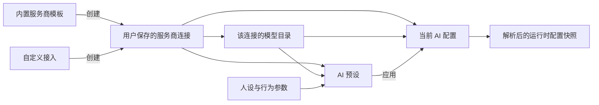

# AI 服务商连接与模型选择调研

> **状态：历史调研（已被实现取代）。** 本文记录 2026-11-13 的方向调研与设计建议；服务商连接库、模型选择、预设绑定与迁移已随 `codex/ai-provider-connections` 分支落地，行为约定请以[服务商连接与模型目录](ai-provider-connections.md)为准。文中“尚未改造”等表述仅代表当时的进度。

调研日期：2026-11-13。本文用于确认产品方向与后续改造范围。

核查了 Mutter 当前实现、Cline 公开桌面端及其 SDK 源码、OpenCode 官方文档、Roo Code 官方配置预设文档。Cline 源码固定在提交 `72b3d7140553a733242126e51a7c2e87efe75c64`；桌面端代码位于仓库的 `apps/examples/desktop-app`。结论来自源码与文档核查，未运行 Cline 安装包。

**建议采用“服务商连接库 → 各连接的模型目录 → AI 配置与预设引用”的结构。Cline 可以作为主要参考，OpenCode 和 Roo Code 分别补充模型引用、参数分层与预设切换的思路。**

## 1. Cline 是否符合目标

Cline 是开源项目，仓库标注 Apache-2.0，并公开了桌面端代码。[Cline 仓库](https://github.com/cline/cline)

| 已核实的逻辑 | 对 Mutter 的意义 |
|---|---|
| 服务商目录区分已配置与可配置项，支持搜索 | 内置模板继续提供接入入口，日常选择优先展示自己配置过的连接 |
| 单独的“添加服务商”表单 | 自定义接入可以命名、保存和反复使用 |
| 自定义表单保存名称、唯一 ID、Base URL、Key、模型列表和默认模型 | 连接信息不必在每份 AI 预设中重复输入 |
| 高级项包含请求头、超时、模型来源 URL、能力声明 | 可以容纳中转、自建服务及不同网关要求 |
| 服务商详情支持刷新模型、手动补模型、搜索模型和收藏 | 自动目录与人工维护可以共存 |
| 使用时分别搜索服务商与模型，并记住各服务商上次使用的模型 | 切回原服务商时恢复熟悉的选择 |

服务商管理与模型收藏见 [provider-list-view.tsx](https://github.com/cline/cline/blob/72b3d7140553a733242126e51a7c2e87efe75c64/apps/examples/desktop-app/webview/components/views/settings/provider-list-view.tsx#L273)。自定义字段见 [add-provider.tsx](https://github.com/cline/cline/blob/72b3d7140553a733242126e51a7c2e87efe75c64/apps/examples/desktop-app/webview/components/views/settings/add-provider.tsx#L29)。选择器见 [chat-input-bar.tsx](https://github.com/cline/cline/blob/72b3d7140553a733242126e51a7c2e87efe75c64/apps/examples/desktop-app/webview/components/views/chat/chat-input-bar.tsx#L2400)，选择记忆见 [model-selection.ts](https://github.com/cline/cline/blob/72b3d7140553a733242126e51a7c2e87efe75c64/apps/examples/desktop-app/webview/lib/model-selection.ts#L1)。

有两处需要准确理解：

- 当前桌面端的“添加服务商”界面明确面向 OpenAI 兼容服务。底层有协议和客户端路由能力，但不能据此认为在这个表单里填任意原生协议地址就能使用。见 [settings-view.tsx](https://github.com/cline/cline/blob/72b3d7140553a733242126e51a7c2e87efe75c64/apps/examples/desktop-app/webview/components/views/settings/settings-view.tsx#L522) 与 [ProviderConfig](https://github.com/cline/cline/blob/72b3d7140553a733242126e51a7c2e87efe75c64/sdk/packages/llms/src/providers/config.ts#L300)。
- 自定义模型可以手动填写，也可以指定模型来源 URL；新增时至少需要得到一个模型。源码并非承诺所有任意接口都能自动发现模型。见 [local-provider-service.ts](https://github.com/cline/cline/blob/72b3d7140553a733242126e51a7c2e87efe75c64/sdk/packages/core/src/services/providers/local-provider-service.ts#L579) 与 [model-source.ts](https://github.com/cline/cline/blob/72b3d7140553a733242126e51a7c2e87efe75c64/sdk/packages/core/src/services/providers/model-source.ts#L17)。

因此，Cline 符合“内置服务商 + 可保存的自定义服务商 + 模型快捷选择”这个核心目标。Mutter 的整套 AI 行为预设仍需按自身用途设计。

## 2. 其他开源工具补充了什么

| 工具 | 可借鉴的做法 | 在 Mutter 中的用途 |
|---|---|---|
| Cline | 服务商管理、每个服务商的模型目录、添加自定义服务商、模型搜索与收藏 | 作为连接管理与日常选择的主要参考 |
| OpenCode | 服务商和模型有明确标识；自定义服务商声明运行协议、地址和模型；模型元数据描述能力、限额与参数 | 为引用、参数表单和运行时解析提供清晰结构 |
| Roo Code | 命名配置预设包含服务商、模型和参数，支持快速切换与置顶 | 改进现有 AI 预设库的使用体验 |

OpenCode 的服务商与模型配置见 [Providers](https://opencode.ai/docs/providers/#custom)，能力、参数和覆盖顺序见 [Models](https://opencode.ai/docs/models/)。Roo 的预设内容、切换和置顶见 [API Configuration Profiles](https://github.com/RooCodeInc/Roo-Code-Docs/blob/main/docs/features/api-configuration-profiles.mdx)。

从这三个项目可以归纳出共同方向：**先把可复用的接入信息保存好，再在使用位置选择服务商与模型，并按需要保存参数组合。** 各项目对连接、模型配置和整套行为预设的边界并不完全相同；下面是针对 Mutter 的设计建议。

## 3. Mutter 当前缺少哪一层

| 当前位置 | 当前行为 | 改造方向 |
|---|---|---|
| `AiProviderPreset.GetDefaults()` | 内置列表提供地址、默认模型与模型名数组；“自定义”是一项空模板 | 保留为创建连接时可选的内置模板 |
| `AiSettings.vue` 的模型连接卡片 | 选服务商只填地址与默认模型，Key 保留；模型仍为自由文本 | 改成选择已保存连接与该连接下的模型 |
| `AiConfigInputDto` / `AiConfigEntity` | 当前配置直接保存一份地址、Key、模型名 | 当前配置保存连接引用与模型标识 |
| `AiPresetConfigDto` / `AiConfigPresetEntity` | 保存整套配置快照；可另存 Key，未存则应用时沿用当前 Key | 新预设引用连接，保留各自的人设和参数 |
| `ConfigRepository.GetAiConfigAsync()` | 直接从当前配置读取地址、Key、模型名 | 统一解析连接、模型和预设参数，生成运行时快照 |
| `HttpModelTransport` / `AiModelExecutor` | 已有 OpenAI 兼容与 Gemini 原生调用通道 | 由明确的协议配置路由，新增协议分别实现适配 |

一个具体例子：现在选择“DeepSeek”之后再选择“通义千问”，前端只改地址和默认模型，原 Key 仍留在表单。这说明现有服务商选择器还承担不了多连接管理。新结构中，每条连接应拥有自己的 Key，切换连接时一并切换其凭据。

## 4. 建议用户实际看到的操作

### 4.1 日常设置保持简洁

“模型连接”卡片可以收敛为：

```text
模型连接                                [管理服务商]

服务商    [百炼 · 主账号                 ▾] [+ 添加]
模型      [搜索或选择模型                ▾]
          收藏 / 最近使用 / 该服务商的模型

当前连接  已配置密钥 · OpenAI 兼容
          [测试当前模型]
```

这里的“服务商”实际指一条已保存连接。可以同时存在“百炼 · 主账号”“百炼 · 备用账号”“公司网关”“本机模型”等条目。内置模板在添加流程中选择；已经保存的内置与自定义连接在日常使用中享有相同能力。

模型选项显示友好名称与准确模型 ID；按当前连接展示模型，支持搜索与收藏，并记住该连接最近选用的模型。“最近使用”是建议新增的快捷体验，不将其描述为 Cline 已具备完整最近列表。

### 4.2 管理服务商承载接入配置

添加流程：选择内置模板或自定义 → 填写连接名称、地址与 Key → 获取或手动添加模型 → 保存。

管理页或弹窗提供：

- 连接列表：名称、来源、配置状态、模型数量，以及当前使用或被预设引用的提示。
- 基础连接信息：名称、协议、Base URL、认证方式与 Key。
- 模型管理：获取列表、手动添加、修改显示名、收藏、隐藏及设置默认模型。
- 高级连接选项：自定义请求头、超时；模型来源 URL 可作为后续增强。

普通用户不必填写内部 ID；由程序生成稳定 ID。名称和地址变更不应导致预设引用失效。同一家服务商的多个账号、区域或中转地址应能分别保存。

### 4.3 编辑预设复用相同选择器

例如保存两份预设：

| 预设 | 连接与模型 | 行为参数 |
|---|---|---|
| 日常聊天 | 百炼 · 主账号 / 某聊天模型 | 日常人设、较低输出预算 |
| 长文讨论 | 公司网关 / 某长上下文模型 | 讨论人设、较高输出预算 |

创建或编辑预设时直接选择已有连接和模型，再配置 Temperature、输出上限、上下文、人设与搜索策略。只切换模型时保留其余有效参数；应用整份预设时使用该预设保存的行为配置。

保存连接、选择模型、应用整份预设需要有清晰的生效边界：保存连接只维护连接库；主表单选择后沿用现有保存机制；预设应用沿用当前“应用并保存”的明确操作。

## 5. 数据与运行逻辑建议



建议分清以下对象：

| 对象 | 核心内容 |
|---|---|
| 服务商模板 | 模板 ID、名称、默认地址、协议、示例模型、配置帮助 |
| 用户连接 | 稳定连接 ID、显示名、模板来源、协议、地址、认证信息、请求头、超时 |
| 连接下的模型 | 连接 ID、准确模型 ID、显示名、来源、可选能力与限额、显示与收藏偏好 |
| 当前配置或预设 | 连接 ID、模型 ID、人设与行为参数 |
| 选择偏好 | 每条连接上次选择的模型，以及按连接和模型共同标识的收藏、最近记录 |

“协议”与“服务商”应分别建模。两个不同名称的中转都可能使用 OpenAI 兼容协议；同一服务商品牌也可能提供不同协议。同一模型名通过两个连接访问时，是两个不同的选择项。

### 模型目录与能力

- 内置目录提供起始选项，允许用户补充新模型。
- 对支持列表接口的连接提供获取或刷新操作；OpenAI 兼容连接可以尝试其模型列表接口，其他协议按适配器处理。
- 自动获取失败时保留已有目录和手动模型，展示错误与重试入口。
- 刷新时按模型 ID 合并，保留手动添加项、显示名、隐藏和收藏偏好；模型 ID 按原值传递，不统一转小写。
- 获取到模型列表表示目录读取成功；实际推理权限与连通性由“测试当前模型”验证，二者显示不同状态。
- 上下文上限、图片、推理等能力有可靠来源才填入。未知值明确为未知，允许手动设置；列表中出现模型不等于已验证所有能力。

### 参数与凭据归属

- Key 归属连接。新预设保存连接引用；修改连接 Key 后，引用它的预设使用更新后的 Key。
- 如果需要冻结另一份接入信息，通过复制连接获得独立条目，并在编辑共享连接时提示影响范围。
- 模型元数据提供默认值和能力约束；当前配置或预设保存用户的明确覆盖值。未知能力不伪装成已支持，`0` 与 `false` 仍保留其明确含义。
- 切换模型后校验现有参数与模型限制，明确提示需要调整的值。
- 连接编辑或删除应展示引用关系；首版可要求先解除当前配置和预设的引用，再删除连接。
- 主配置与预设共同走同一个解析入口。每次生成取得不可变配置快照，使地址、Key、模型与参数来自同一次解析。
- 现有联网搜索的验证结果需要按连接、模型及相关配置版本隔离；更换地址、凭据或协议后应失效。

## 6. 迁移与实现范围

建议首版交付完整的连接管理闭环：持久化连接库、内置模板创建连接、自定义 OpenAI 兼容连接、模型列表获取与手动维护、共享选择器，以及预设引用。收藏与每连接选择记忆一并接入，优先服务频繁切换。

当前运行时已有 OpenAI 兼容与 Gemini 原生通道，具体协议支持应以已实现并验证的适配器为准。Anthropic Messages、OpenAI Responses 等协议需要各自适配；它们可以扩展到同一套管理结构中。

旧数据迁移建议：

1. 将当前地址、Key 和模型创建为一条“现有连接”，保持当前有效参数。
2. 含独立 Key 的旧预设，根据协议、地址、认证及相关连接配置建立或匹配连接；不能仅因地址相同就合并不同账号。
3. 未含 Key 的旧预设，只在能确定其连接归属时自动绑定；归属不明确的标为“未绑定连接”，应用前让用户选择。
4. 给预设结构升级版本，并让服务端迁移与运行时解析共同处理兼容，避免只改前端下拉框。

主要改动会涉及前端 AI 设置与预设编辑、配置 DTO、连接与模型的持久化、预设版本迁移、配置仓储解析，以及协议路由。现有人设、上下文和独立搜索配置可以继续作为预设的行为部分。

建议用下列场景验收方向是否成立：

- 两个相同协议的自定义服务商同时存在，重启后仍能分别选择。
- 同一家内置服务商添加两个账号，切换时使用各自的 Key。
- 一个连接添加多个模型，两份预设引用不同模型与参数，应用后调用目标正确。
- 获取模型失败仍能使用已保存目录，并可手动添加准确模型 ID。
- 修改连接名称不影响引用；更新共享 Key 后，引用它的预设使用新值。
- 同名模型在不同连接下能够区分，收藏与最近选择互不串用。
- 旧配置迁移后仍可调用；无法确定连接的旧预设有明确待绑定状态。

本轮产出是调研与设计建议；后续已按此结构实现，见[服务商连接与模型目录](ai-provider-connections.md)。
