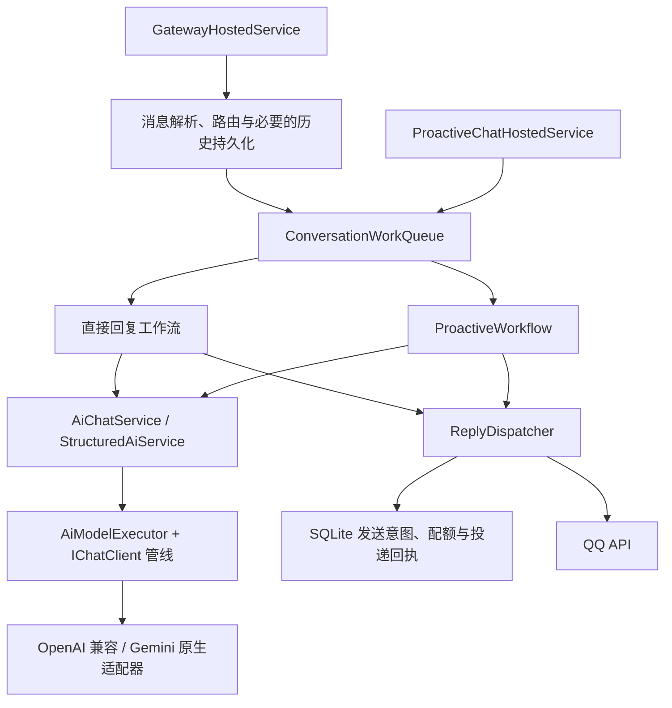

# AI 与消息运行时

Mutter 保持单进程、SQLite 和现有配置接口。运行时采用会话调度、应用工作流、统一 AI 执行入口和协议适配器。配置预设、QQ 搜索形状和图片处理继续兼容。



`GatewayHostedService` 由 Generic Host 管理。WebSocket 接收循环只负责解析和入队，单消费者事件队列按到达顺序执行落库、SignalR 通知和互动 ACK，避免一次 1.5 秒的按钮响应阻塞后续消息与心跳。消息处理完成接纳后即返回，耗时生成交给 `ConversationWorkQueue`。同一群或私聊按顺序执行，不同会话可并行。队列最多接纳 256 项、单会话 16 项，包含正在执行的工作。执行槽为 3，主动工作最多占 1 个槽。用户工作在 2 分钟后过期并得到超时提示；主动工作等待超过 45 秒即跳过。同一会话仍遵守入队顺序。

事件队列最多缓冲 1024 条，跨连接重用，成功入队后才推进恢复序号；普通断线不会取消已接纳事件。关闭网关时先停止收包，最多等待 5 秒排空，再取消剩余处理并记录未完成情况；处理器在交接结束后退订。此内存队列不提供进程崩溃后的持久化恢复。

停机时队列直接订阅宿主的 `ApplicationStopping` 事件关闭入口，已接纳的任务继续使用队列自己的令牌排空；只有排空期限到达才取消剩余工作，随后释放宿主并执行待替换文件的更新。队列满时明确拒绝接纳，不创建额外的后台任务。需要保存的用户消息在触发通知和生成前写入数据库；只允许观察的群消息仍只进入内存窗口。

**模型接入。** `IAiChatService` 继续作为业务外观。`AiModelExecutor` 使用 `Microsoft.Extensions.AI` 10.0.0 的稳定 `IChatClient` / `ChatClientBuilder` / `DelegatingChatClient`，统一消息、取消和调用记录。新增此依赖的目的，是复用标准调用契约及可组合管线，减少业务对具体客户端的耦合；不引入外部遥测上传或新的云服务。

现有 HTTP 序列化保留在 Infrastructure 的自定义适配器中，避免 SDK 丢失中转站搜索参数。每次调用绑定一份配置快照，不通过修改共享鉴权头实现模型切换；进行中的请求使用原快照，下一轮读取新配置。普通聊天、图片字节、JSON mode、厂商搜索参数、模型用量及 Gemini 截断原因均经过映射。

当前传输保持非流式行为，`IChatClient` 的流式入口返回一次完整更新。严格 JSON Schema、本地函数调用、URI 多模态内容和服务端有状态会话需要另行适配，当前会明确拒绝，避免静默忽略。接入 `IChatClient` 不代表所有 Provider 拥有相同能力。

**调用成本与容错。** 一条生成流程共享 120 秒截止时间和最多 4 次真实 HTTP 尝试；会话工作另有 3 分钟执行上限。生成成功后，投递使用独立的 30 秒期限，不再被模型截止时间截断；停机时队列令牌仍可立即取消投递。结构化模式只在明确格式不支持或内容无法解析时降级。鉴权失败、网络中断、超时和 5xx 不因格式降级而重新生成；输出截断也不按相同输出上限再试一次。协议已知拒绝仍可按既有搜索策略降级。

结构化重试、图文两阶段成功返回的用量会累加。每次实际 HTTP 调用的用途、请求人、耗时、已返回的 token 与失败类型现持久化到 `AiCallRecords`，不新增提示词或原始响应遥测。管理员手动探测也记账。上游没有返回的用量保留未知；已保存的调用不依赖生成或发送是否成功，并通过操作关联避免和回复重复统计。旧版仅有回复级用量，单独标记，不还原实际请求数或用户归属。详见 [性能与面板改进](panel-improvements.md)。

**输入预算。** `MaxTokens` 继续控制输出。新增 `ContextWindowTokens`（默认 32768）与 `MaxInputTokens`（默认 24576）分别表示模型容量和本地输入上限，支持面板及预设保存。实际输入预算取本地上限与“模型容量减输出预留、1024 安全余量”中的较小值。最终检查包含系统词、人设、当前消息、历史、图片及 JSON mode 余量。优先逐条裁掉旧历史；当前消息与固定提示本身超限时，调用前报错。择机判定输出上限会按当前模型窗口收敛，至少保留 512 token 输入空间；含图请求仍超限时先移除图片重试一次，正文也放不下才失败。

这里仍采用估算：文本每个 UTF-16 字符按 1 token，图片每张预留 4096 token。它不能替代各模型的 tokenizer 或图片计价规则，切换模型时应按服务商规格校准容量和预算。历史条数仍独立限制输入，不会为了填满预算补入更多消息。

**投递与配额。** `OutgoingReplies` 将生成结果与平台发送分开，状态为 `pending / sent / failed / unknown / skipped`。先持久化发送意图，再调用平台；只有确认发送后才加入 `ChatMessages`。发送前取消（停机或投递期限到达）记为 `skipped_cancelled`，平台尚未收到请求，不计入未知结果；只有真正开始调用平台接口之后的取消才保留 `unknown`。网络结果不确定时保留 `unknown`，不补发主动消息。`pending` 和 `unknown` 不会在启动时自动重放，需结合平台消息和本地日志核查。主动发言的落库结论只接受已知结果码，平台原始错误文本只写入详情。

平台确认成功后，回执或月度展示计数写入失败不会反转成发送失败。未完成回执的意图仍保留，并保守计入主动冷却及日配额。这种方式不承诺外部 QQ API 的 exactly-once 投递。

主动工作开始时检查内存及持久化配额；真正发送前重新读取全局开关、群启用状态、参与状态、静默时段和主动通道设置。SQLite 事务内预占群/全局日配额及冷却，防止并发群同时越过上限。升级前已有的主动聊天记录也参与配额计算。`ActiveMessageAttempts` 在发送前原子检查并持久化每次主动 HTTP 尝试的分钟/日限制，富消息降级的真实重发也计数。

新版本的尝试记录可在重启后恢复；旧版本只保留月累计，首次升级时无法精确还原升级前的主动发送日计数。观察窗口仍可随重启丢弃。

**数据库兼容与回退。** 升级新增 `OutgoingReplies`、`ActiveMessageAttempts`、`AiCallRecords`、`AiUsageArchives`、操作关联列、AI 配置的预算/普通回复记忆开关和查询索引，使用现有幂等升级流程，不删除业务表或历史记录。`AiUsageArchives` 仅保存已清理明细的累计计数和用量，清理与归档在同一事务完成。新配置预算默认 24576，已有预算不重写；为缺少预算列的旧配置补列时仍使用原升级默认值。回退程序版本时保留数据库及新增列/表，无需执行 DROP 或删除数据；旧程序不读取归档累计值，重新升级后恢复显示。

验证命令：

```powershell
dotnet build Mutter.sln
dotnet run --project tools/ProactiveCheck -- --logic-only
dotnet run --project tools/ProactiveCheck -- --runtime-only
cd web
npm test
npm run build
```

`--logic-only` 包含原有纯函数检查与新的运行时回归；`--runtime-only` 单独执行后者。运行时检查使用合成标识符、临时 SQLite 和假 HTTP，不读取部署库、不调用真实 QQ 或付费模型。覆盖会话顺序、队列容量/优先级/过期/停机排空、最终请求预算与附图降级、协议映射、重试与用量、动态配置、发送前取消、投递失败、回执失败、配额恢复、并发预占、发送前策略及旧模型升级。
