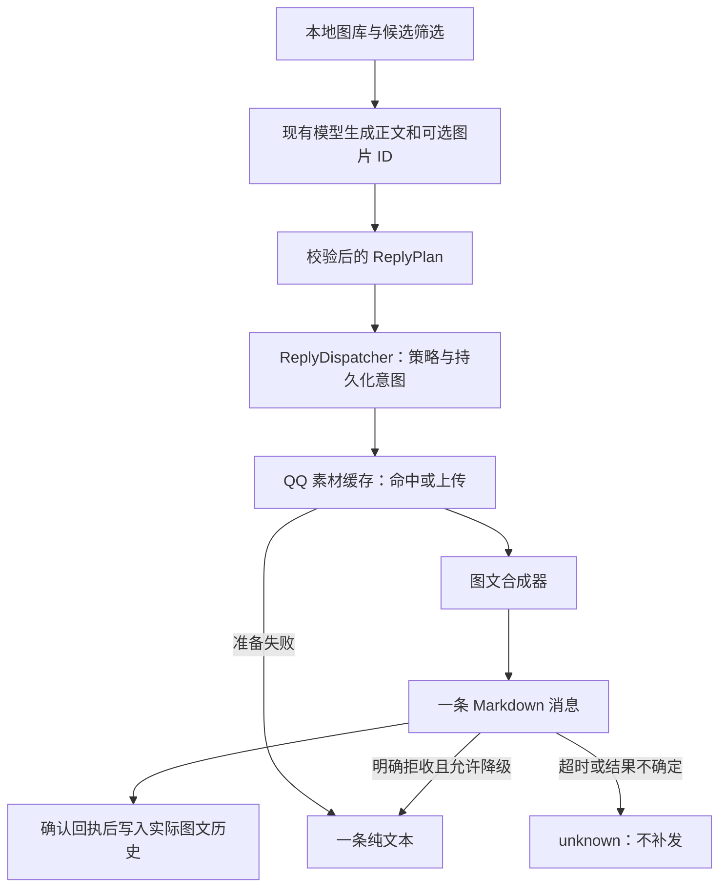

# Mutter 图片消息设计

调研日期：2026-11-18（Asia/Shanghai）。基于当前仓库源码与 QQ 现行官方文档；本次交付为设计，没有调用真实机器人发送消息，也没有修改运行时代码。

## 设计结论

采用 **轻量本地图库 → AI 选择图片 ID → QQ 平台素材 → 单条图文 Markdown → 统一投递账本**。

首期聚焦管理员提供的表情包和配图，让 Mutter 在回复中适量选用。图片文件存在本机，标签与使用范围存在现有 SQLite；QQ 素材库承担发送缓存。继续使用单进程部署，不引入图床、对象存储、向量数据库或新的常驻服务。联网找图、生成图片以后接入同一个图片资产入口。

选图是可选行为。普通回复每次最多一张；没有合适图片就只说文字。择机发言先保留现有“是否开口”的判断，再决定配图，不让图片触发额外插话。

## 调研中确认的能力

| 能力 | 官方现状 | 对设计的影响 |
| --- | --- | --- |
| 群聊、私聊自定义 Markdown | 官方注明自 2026-04-23 起全部机器人可用；频道另有要求 | 图文可以放进同一条 `msg_type=2` 消息，仍尊重 Mutter 的富消息开关及运行时降级 |
| Markdown 图片素材 | `prepare → PUT → complete` 返回 `qqbot-media://image/v1/...` | 本地图片也能发送，无需部署公网图床 |
| 平台素材限制 | png/jpeg/gif/webp；单张不超过 10MB；单机器人最多 100 张；成功引用后滑动续期 90 天 | 本地图库与平台缓存分开；需要按内容复用、清理及过期处理 |
| 图片严格校验 | `markdown.force_verify_image_resource=true` 时，转存失败会拒绝整条消息 | 首选整条失败后降级，避免文字已发出却没有图片 |
| 原生图片消息 | 向群/私聊 `/files` 上传，再以 `msg_type=7` 和 `media.file_info` 发送 | 可作为独立图片发送的兼容通道；它与 Markdown 素材是两套接口 |
| 图片上传自动发送 | `/files` 的 `srv_send_msg=true` 会直接发消息，占用主动消息频次 | 使用 `false`，所有用户可见发送继续经过统一投递出口 |

依据：[Markdown](https://bot.q.qq.com/wiki/develop/api-v2/server-inter/message/type/markdown.html)、[素材管理](https://bot.q.qq.com/wiki/develop/api-v2/server-inter/message/material-management.html)、[群聊发送](https://bot.q.qq.com/wiki/develop/api-v2/autogen/api/v2_groups_group_openid_messages.post.html)、[单聊发送](https://bot.q.qq.com/wiki/develop/api-v2/autogen/api/v2_users_user_openid_messages.post.html)、[富媒体概述](https://bot.q.qq.com/wiki/develop/api-v2/server-inter/message/rich-media.html)。

需要区分三个值：本地 `asset_id` 交给 AI 选择，`qqbot-media://...` 交给 Markdown 渲染，`file_info` 交给原生富媒体消息。它们不能相互替代。平台素材引用绑定机器人 AppID；群聊与私聊的 `/files` 上传结果也有场景隔离。

## 现有代码的接入点

| 位置 | 当前行为 | 应改内容 |
| --- | --- | --- |
| `Models/AiChatResponse.cs` | 只有字符串正文和用量 | 保留用量模型，增加独立的回复计划及解析步骤 |
| `Models/OutgoingReply.cs` | 发送意图只有 `Content` | 增加计划图片与实际送达图片的持久化字段 |
| `Services/ReplyDispatcher.cs` | 文本或来源链接 Markdown；去重只计算正文 | 接收图片计划、准备素材、合成图文，去重包含图片内容哈希 |
| `Models/QQOfficial/RichMessage.cs`、`SendMessageRequest.cs` | `OutboundMessage` 与 `From()` 实际只产生 0/2；虽然 DTO 已有 `media` | 明确区分文本、Markdown、原生媒体；补充严格图片校验字段 |
| `Infrastructure/Services/QqBotApiService.cs` | 旧 `UploadMediaAsync` 指向 `/v2/files/upload`，只返回字符串并吞掉异常 | 新建正式素材上传接口；后续原生通道接入时改用现行群/私聊 `/files`，保留错误类别与取消语义 |
| `Infrastructure/Repositories/OutgoingReplyStore.cs` | 确认发送后才写历史，但没有图片字段 | 保存实际发送格式、图片引用和 `HasImage` |
| `Infrastructure/Ai/ProviderChatClient.cs` | 显式拒绝本地函数调用、严格 Schema | 首期用 JSON mode/提示词结构化输出，不以工具调用改造为前提 |
| `Services/AiReplyMarkdownFormatter.cs` | 将 HTTP 链接收集到来源行 | 只处理正文与来源，图片由独立合成器追加；直接用它处理图片语法会误拆链接 |
| `ProactiveVerdict`、`ProactiveWorkflow`、`ProactiveSpeaker` | `line` 非空才发言，后续可能联网改写 | 配图附属于最终发言，不改变原判定门禁 |
| `ChatTimelineDto`、`ChatTimelineReader`、`web/src/views/ChatHistory.vue` | 只返回/展示 `HasImage` 标记 | 新增实际已发送附件 DTO 与同源预览 |

表中省略的 Core 文件路径均相对于 `src/Mutter.Core/`。基础运行时及“不确定时不重放”的语义继续遵守 [AI 与消息运行时](ai-runtime.md)。

## 图库：先做小而完整的版本

### 入库与存储

支持两种管理员入口，共用一个入库服务：

1. 文件夹导入：把图片和可选的标签清单放进指定导入目录，管理员触发扫描。无清单时以文件名作为待编辑标题。
2. 面板上传：上传文件，填写标题、简短描述、标签和可用范围，预览后启用。

不需要先给每张图调用视觉模型。管理员描述足以支持首期选图；后续可以增加“AI 辅助补标签”，由管理员确认后保存。建议先整理 20～40 张描述明确的常用图，覆盖庆祝、鼓励、疑惑、无语等场景，验证实际使用后再扩充。

图片落到安装目录下的 `data/media/assets/`，文件名由 SHA-256 内容哈希决定，原始名称只作元数据；通过临时文件加原子重命名入库。它是运行数据，不进 Git，不放 `wwwroot`。实施时同步补齐 `.gitignore`、Windows/Linux 更新器保护及部署/备份说明，升级不能替换、清理或把用户图库混入程序备份。

建议首期本地限制：单张 3MiB、总文件容量默认 512MiB、每条回复一张。3MiB 是 Mutter 的保守产品限制，给原生通道的二进制直传及 Base64 膨胀留出余量，并非 QQ 的 10MB 平台上限。接受 png/jpeg/gif/webp，校验真实文件类型、尺寸与扩展名，不只信任上传头；首期超限明确拒绝，不承诺自动转码。

图片文件保持不可变。编辑标题、标签不改变图片哈希；替换图片生成新版本，历史记录仍引用发送时的版本。停用图片仅影响之后的选择，历史预览继续按保留策略可读；主动删除历史原文件后显示“图片已清理”。

### 两张小表

| 表 | 主要字段 | 用途 |
| --- | --- | --- |
| `ImageAssets` | `Id`、`Sha256`、相对路径、MIME、大小/尺寸、标题、描述、标签、范围、启用状态、创建时间 | 管理本地图库与选择权限 |
| `QqImageMaterials` | `AppId`、`AssetHash`、`ImageId`、素材 URI、到期时间、最后确认使用时间、管理归属 | 缓存 QQ 平台素材句柄，唯一键为 `(AppId, AssetHash)` |

默认图片由管理员明确标为全局可用，也可限定群聊或私聊对象。筛选候选与实际发送时都检查范围。群友发来的图片不自动收入全局图库；后续支持收藏时，需要保留来源范围并由管理员确认。

## AI 如何选图

运行时先按“当前消息 + 近期上下文 + 人设”在启用图库中做标签、描述关键词匹配，最多给模型 8 个候选。关键词命中不足时，可以由管理员指定的常用表情补足，避免只会匹配字面词而无法表达鼓励、疑惑等语气。候选内容总长建议限制在 1200 字符以内，并纳入现有最终输入预算；预算紧张时先减少候选，保留正文能力。没有候选时沿用原聊天请求，不改变输出格式。

每个候选只给逻辑 ID、描述、适用场景和禁用场景。例如：

```json
{
  "id": "sticker_cat_speechless",
  "description": "一只猫沉默地看着镜头",
  "tags": ["无语", "愣住", "轻松吐槽"],
  "avoid": ["严肃求助", "针对个人的嘲讽"]
}
```

同一次生成输出正文及可选图片，不增加独立的选图模型请求：

```json
{
  "text": "这操作，猫看了都得沉默一下。",
  "image_id": "sticker_cat_speechless"
}
```

无图时 `image_id` 为 `null`。模型只能选择本轮候选，服务端复查 ID、启用状态和使用范围，再转换成包含资产 ID、内容哈希和说明的 `ReplyPlan`。不接受模型提供的本地路径、URL、Base64 或平台素材引用。

普通聊天复用当前完整上下文及附图能力，在存在候选且功能开启时加入回复结构约束。正文仍保持既有人设和纯文本约束，JSON 外壳由运行时提示说明，平台 Markdown 由应用负责。已确认支持 JSON mode 的模型使用 `json_object`；其余模型用提示词要求 JSON 并复用现有容错提取。明确不支持格式时沿用已有有界降级机制；普通解析失败不额外发起一次选图调用。正文可可靠提取时丢弃非法图片 ID；返回普通文本时按文本发送；只剩截断/损坏 JSON 时使用既有生成失败提示，不把控制字段发给群友。

择机发言在原有 verdict 上增加可选 `image_id`，`line` 仍是唯一开口条件。`line` 为空时即使选了图也不发。发生联网改写时，原选图容易与最终语气不符，首期直接舍弃图片；以后再让改写阶段一并确认图片。图片重复冷却由应用控制：建议同会话至少 10 分钟内不重复同一张，自主配图至少间隔 3 次已发送回复；用户明确点名某张图时可豁免配图频率，仍遵守平台和会话发送限制。

## 发送：单条图文是首选



素材上传实现放在 Infrastructure，建议接口为 `IQqImageMaterialService.GetOrUploadAsync(asset, ct)`；回复合成与选择策略放在 Core。上传 HTTP 调用不占模型尝试预算，整个过程仍在现有会话任务和独立的投递截止时间内执行。

首次使用图片：

1. 在上传前复查发送策略，持久化包含图片资产 ID/哈希的发送意图。
2. 对实际文件计算 MD5、SHA-1，调用 `POST /v2/media-images/prepare`。
3. 使用独立、无 QQ 鉴权头的 HTTP 客户端 PUT 图片到返回的预签名 URL，`Content-Type` 与 prepare 完全一致。
4. 取 PUT 响应 ETag，调用 `POST /v2/media-images/complete`，持久化 `image_id`、素材 URI 和有效期。
5. 合成 Markdown；真正发消息前再次检查群开关、范围、静默和发送通道，取得共享 `msg_seq` 或主动发送配额，发送一条图文消息。

命中有效缓存时直接执行最后一步。准备上传串行于同一资产的缓存更新，同一个 `(AppId, Hash)` 的并发上传合流；锁与缓存均有容量上限，调用方取消不影响其他等待方，底层上传也有自己的有限期限。

示意请求：

```json
{
  "msg_type": 2,
  "msg_id": "synthetic-incoming-message",
  "msg_seq": 1,
  "markdown": {
    "content": "这操作，猫看了都得沉默一下。\n\n",
    "force_verify_image_resource": true
  }
}
```

正文、来源链接、图片分别构造。先调用现有来源排版逻辑，再追加应用生成的图片段，避免正则把图片当来源链接抽走。素材 URI 必须来自当前 AppID 的上传结果，说明文本转义并限长；显示宽高按原比例收敛到合理尺寸，不能把本地路径或临时预览 URL 发出去。所有字段和换行都计入最终 Markdown 长度，超限时优先去掉图片而不截断 URI。

素材服务与 Markdown 发送能力分别记录状态。图片内容错误、单张过期和素材额度满只影响对应资源；不应让全局 Markdown 被停用。只有明确的能力/权限错误才进入相应能力降级。当前 `RichUiCapability` 的 Markdown 状态需能区分群聊/私聊，后者也要补上主动富消息入口，避免只支持群主动图文。

## 平台缓存与上传预算

平台最多 100 张，因此本地图库按需上传。建议缓存软上限 80 张，按平台列表的 `total` 统计整个 AppID 的占用，给其他功能留余量。到达软上限或明确返回额度错误时，串行清理 Mutter 已登记管理、未置顶、未被正在发送任务使用的最久未用素材；不删除其他工具或管理员自行管理的素材。没有可释放资源时，跳过配图并记录原因。

平台删除只针对缓存；本地原文件保留，下次使用可再上传。已发送消息由平台保留副本，不受素材删除影响。素材 URI 与 `image_id` 可以持久化，短时效 `preview_url` 和预签名 PUT URL 不持久化、不写日志；管理面板通过本地原文件预览。

90 天是滑动窗口，成功发送引用后才更新本地确认使用时间。根据服务端列表的 `expires_at` 对账；临近过期或确认失效时重新上传，带安全余量，不把“本地选择过”当成“已续期”。complete 结果不明时避免连续 prepare 造成槽位泄漏，先保留待核查状态、通过自己的文件标记与素材列表对账。

现有独立投递期限为 30 秒，建议给素材准备最多 8 秒，上传并发上限 2。管理员入库后可在独立受限任务中预热，但不依赖预热成功。冷缓存或上游超时只影响配图，不延长整条回复等待；留给正文发送足够时间。

## 失败、去重与记账

首期维持“一次回复最终至多一条用户可见消息”。默认图文失败后退文字；不默认拆成“正文一条、图片一条”，因此无需在首期引入多消息事务和部分成功状态。独立纯图片可通过原生 `msg_type=7` 扩展；如果以后要求自动拆开发图，必须先增加每个发送部分的回执与配额记录。

| 情况 | 行为 |
| --- | --- |
| 图片不存在、范围不符、没有候选 | 不选图，原正文正常发送 |
| 素材准备失败或超时，还未调用消息发送 | 从计划中移除实际附件，发送正文；不记为消息发送结果未知 |
| Markdown 明确无权限/配置关闭 | 普通回复发送正文；图片功能配置需同时展示 Markdown 前提 |
| 单张素材明确过期 | 预算允许时刷新一次，或退正文；不关闭全部图片/Markdown 能力 |
| 平台明确拒收且属于格式、素材或能力问题 | 允许一次无图降级，取新的 `msg_seq`，主动通道每次真实发送尝试都计数 |
| 违规内容、接收方拒收、禁言、关系错误、频控 | 按对应失败处理；不通过改格式或切主动通道继续发送同一内容 |
| 消息 HTTP 已开始后网络中断、超时、5xx、回执不明或审核中 | 保守记 `unknown`/待确认，不重发、不换通道补发 |
| 发送前停机取消 | `skipped`，保留可核查意图；上传成功本身不表示发言成功 |
| 已确认发送，历史回执写库失败 | 保留确认结果和待核查意图，不重新发送 |

需要让 `sendStarted` 只覆盖用户可见的消息 HTTP，素材上传不是消息发送。新增分类按 HTTP 状态及官方业务码判定，保留 trace ID；不能沿用旧上传接口“所有异常变 null”，也不能把所有非 5xx 业务错误都当成可安全换通道重发。

`OutgoingReplies` 增加版本化的计划附件 JSON、实际送达附件 JSON、最终格式；用现有 `Detail` 记省略原因。`DeliveryResult` 携带实际附件，只有平台确认图文送达才设置 `HasImage=true`。正文降级时不能把原计划图片写成已发送。

去重指纹改为“会话 + 正文 + 有序图片内容哈希”，避免同正文不同图被吞、不同 ID 同一图片绕过去重。主动择机冷却和日配额按一次逻辑发言计算；平台主动发送尝试按每次 `/messages` 调用计数。素材 prepare/PUT/complete 单独限并发和上传频率，不消耗消息序号或发言次数。

## 历史记录与面板

历史保存正文及实际发送附件的资产 ID、版本哈希、说明、MIME 和尺寸；不覆盖原入站 `RawSegmentsJson` 的旧字符串数组契约。新增可空的版本化附件字段，旧消息没有该字段时仍照常显示。

新附件 DTO 接入 `/api/chat/timeline` 与对应 SignalR 通知，保持分页快照和决策关联不变；不要把新功能接到已废弃的 `/api/chat/history`。列表只返回轻量元数据，图片通过同源鉴权接口按需加载、懒加载缩略图、点击查看原图。它同时符合现有只允许同源图片的 CSP，不需要放开到任意外网域名。

上下文构建保留文字，并为已确认送出的图附短说明，例如“[已发送表情：无语的猫]”。不把 Base64、素材 URI 或完整图库塞进历史上下文；图片发送失败时也不能声称发过图。生成候选的文本预算与回复 Token 用量继续进入既有调用记录。

面板初版可在 AI 设置增加“回复配图”和简单图库抽屉：上传、预览、编辑标签/范围、启停、手动删除及配额状态。全局开关与群/私聊覆盖配置在服务端收敛，出站配图配置与现有用于看图的 `MaxAttachedImages` 分开命名。升级后默认关闭；用户启用时同时解释并配置既有 RichUi 总开关、Markdown 和群白名单，不留下“图片已开却永远不会发”的配置组合。

当前 Kestrel 与 Nginx 总请求上限为 1MB。上传接口按路由单独放宽到约 4MiB（含 multipart 开销），仍以实际文件 3MiB 和流式累计字节数为准；前端必须保留写请求鉴权及 CSRF 头。其余接口继续保持原有限制。Nginx 位置匹配、后端请求上限和 multipart 表单限制需一起核对。

## 安全与部署边界

- AI 只拿 ID，不拿文件路径；读取、删除与导入都限制在明确的媒体目录，拒绝路径穿越及越界链接。
- 只处理图片白名单，拒绝 SVG/HTML 伪装；服务端文件头、大小与尺寸校验不可只依赖前端或 QQ。缩略图如引入解码器，应同时限制解码像素和动图帧预算。
- 图片 GET/预览接口复用面板授权，返回真实图片 MIME 和 `nosniff`；素材上传和所有写操作保留现有鉴权/CSRF 约束。
- 首期不下载任意模型 URL。后续联网找图需要专用公网下载策略，包含解析后 IP 和每跳重定向检查。现有 `OutboundAddressPolicy` 为支持本地 AI/搜索服务允许私网，不能直接当成公开找图的完整 SSRF 防护。
- 素材 PUT 使用返回且经过 HTTPS/目标校验的预签名地址，禁用自动重定向，不附带 QQ Token；API 鉴权客户端与对象存储上传客户端隔离。
- 图片数据、用户来源、临时签名 URL 和 Base64 不进入日志。数据库结构升级沿用 `EnsureSchemaUpgradedAsync` 的幂等加表/加列方式，不修改冻结的 EF 迁移。

## 建议实施顺序与验收

| 步骤 | 可交付结果 |
| --- | --- |
| 1. 图文发送底座 | 受控本地资产、QQ 素材上传缓存、图文合成、统一投递、准确历史预览；用合成图片验证群聊和私聊 |
| 2. 轻量图库与普通回复 | 文件夹导入/面板上传、标签范围、候选检索、同轮选图、重复冷却；默认关闭并可逐群开启 |
| 3. 择机发言接入 | 在既有发言门禁内选择配图，补齐日志；联网改写后首期舍弃原图 |
| 4. 按实际需求扩展 | 联网找图、生图产物、群图收藏、纯图原生发送；仍先入资产再复用发送底座 |

首个可用版本覆盖步骤 1、2。避免为了接图片先全面改造模型工具调用。素材缓存、准确回执和历史预览属于首期完整能力。

实现后的关键自动化验收：

1. 假 HTTP 验证 prepare/PUT/complete 的哈希、MIME、ETag 和鉴权隔离，最终请求不混用 `content`/Markdown/media。
2. 图片候选越权、未知 ID、损坏 JSON、无候选、输入预算不足都能明确降级，正常无图回复行为保持兼容。
3. 同图并发只上传一次；重启复用缓存；过期刷新；100 张满时只清理自身可清理素材；其他素材不受影响。
4. 上传取消与消息发送取消准确区分；消息结果未知时不重发；明确格式拒收可有界降级；违规/拒收/频控不可改通道继续发送。
5. 正文相同不同图片可区分；主动真实发送尝试与逻辑发言配额不混计；群/私聊都有图文入口。
6. 实际附件准确落入历史及上下文；文字降级无假图片；图片删除或历史原文件清理后仍可阅读文字。
7. 验证图片上传的路由限额、鉴权、路径边界，图库目录不被 Windows/Linux 一键更新或保留策略误删。

回归入口：`dotnet build Mutter.sln`、`dotnet run --project tools/ProactiveCheck -- --logic-only`，以及 `web/` 下 `npm test`、`npm run build`；按仓库规范为择机判定分支补断言。最后在 QQ 沙箱或指定测试会话实测静态图、GIF/WebP 的客户端显示、严格校验错误、群/私聊主动与被动发送。官方单聊文档的回复时效字段存在描述差异，实施时保守遵循现有已验证策略，不在图片功能中顺带放宽窗口。

本次仅完成静态调研与设计；以上实现验收尚未执行。

## 官方资料

- [素材管理：平台素材上传、配额、90 天续期与删除](https://bot.q.qq.com/wiki/develop/api-v2/server-inter/message/material-management.html)
- [Markdown：开放范围、图片语法与素材引用](https://bot.q.qq.com/wiki/develop/api-v2/server-inter/message/type/markdown.html)
- [发送群聊消息：字段、严格图片校验及错误码](https://bot.q.qq.com/wiki/develop/api-v2/autogen/api/v2_groups_group_openid_messages.post.html)
- [发送单聊消息：字段与富媒体引用](https://bot.q.qq.com/wiki/develop/api-v2/autogen/api/v2_users_user_openid_messages.post.html)
- [富媒体消息概述：原生图片发送与场景隔离](https://bot.q.qq.com/wiki/develop/api-v2/server-inter/message/rich-media.html)
- [群聊富媒体上传：URL、二进制与分片方式](https://bot.q.qq.com/wiki/develop/api-v2/autogen/api/v2_groups_group_openid_files.post.html)
- [单聊富媒体上传](https://bot.q.qq.com/wiki/develop/api-v2/autogen/api/v2_users_user_openid_files.post.html)
- [API 调用指南：请求地址、鉴权与响应语义](https://bot.q.qq.com/wiki/develop/api-v2/dev-prepare/api-call-guide.html)
