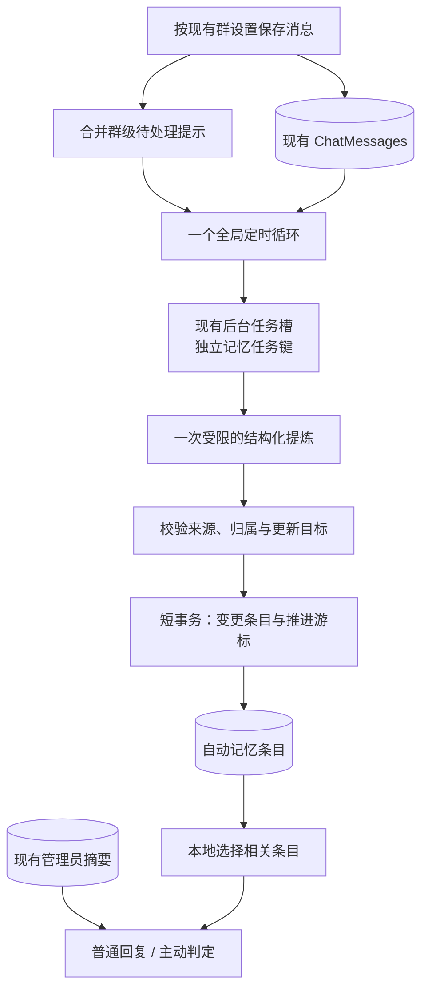

# 轻量群记忆设计

状态：设计参考，更新于 2026-11-14。已实现可组合触发条件、各群独立总结模型、自动提炼与本地召回。实际配置、旧库兼容和成本边界以 [自动群记忆](automatic-group-memory.md) 为准；本文保留设计推导及后续验收建议，不把未测量的参数写成性能承诺。

Mutter 的自动记忆采用“少量短事实 + 后台批量提炼 + 本地按需选择”。复用当前 .NET 进程、SQLite、聊天模型和调用账本。新增两个小表、三个主要组件和一个全局定时循环，第三方依赖增量目标为零。聊天回复前的记忆选择不调用模型。

## 1. 选型依据

重新调研了两个更小的参考项目：

| 参考 | 已公开的做法 | 对 Mutter 的取舍 |
| --- | --- | --- |
| [recallite，原名 memlayer](https://raw.githubusercontent.com/alisaadbaig/memlayer/main/README.md) | Python 标准库核心、SQLite，语义检索为可选项 | 参考单库与可选检索设计；Mutter 已有持久化和模型调用，不额外带入 Python 运行时 |
| [agentmem](https://github.com/oxgeneral/agentmem) | SQLite、命名空间、过期和本地检索；对话自动提取使用正则 | 参考容量和生命周期约束；其文档列出的语言检索与提取方式，不能直接证明中文多人群聊效果 |

这些项目提供了轻量化实现的参考，尚未在 Mutter 中集成验证。采用自研模块的判断来自现有组件的重叠程度，不代表已验证其效果优于这些项目。

## 2. 保留的能力与资源上限

记忆服务于日常聊天：记住明确的群内约定、成员自述偏好和近期活动。现有管理员摘要继续作为固定背景；自动提炼写入独立条目，不覆盖管理员编辑的内容。

| 内容 | 存储示例（均为合成示例） | 生命周期 |
| --- | --- | --- |
| 成员自述 | MemberA 自述不吃辣 | 默认 90 天；新的直接证据可更新 |
| 群内约定 | 本群明确约定每周五晚讨论读书 | 默认 90 天；当前对话可纠正 |
| 临时活动 | GroupA 的活动计划在某个明确日期的 20 点开始 | 到期后停止召回；没有明确日期时最多保留 7 天 |

不从 Bot 自己的回复中提炼事实。第三方对成员的描述不直接形成该成员的偏好；单人建议保留“MemberA 提议”的归属，不升级成群体共识。对不确定、玩笑和转述拿不准时，允许整批返回空结果。

建议初始上限：

| 项目 | 初始值 |
| --- | --- |
| 每群有效自动条目 | 128 条 |
| 单条正文 | 120 个 Unicode 字符 |
| 单条检索标签 | 最多 4 个，每个不超过 12 个字符 |
| 单条来源引用 | 最多 3 条消息 ID，不复制消息正文 |
| 一次回复参考 | 最多 4 条，总计不超过 600 个现有文本预算单位，含标签与说明 |
| 一次学习读取 | 最多 40 条新增人类消息，按本地行 ID 递增 |
| 学习请求完整文本 | 最多 6000 个现有文本预算单位，还须适配所选模型的实际输入上限 |
| 单条聊天送入提炼的正文 | 最多 400 个 Unicode 字符；未读部分不作为证据 |
| 单批变更 | 最多 5 项 |
| 学习输出上限 | 最多 1024 tokens，并受现有窗口预算钳制 |
| 全局学习并发 | 1 |
| 触发设置示例 | 新增 50 条、距上次完成 120 分钟、每天 22:00，可独立开关并同时启用 |
| 单群 / 全局每日模型请求 | 最多 12 / 48 次，失败也计数 |

当前 `AiRequestBudget.EstimateText` 使用字符串长度作保守估算，上述“预算单位”沿用它，不声称等于真实 tokenizer 计数。Unicode 字符的内容长度校验应按 Rune 处理，预算估算继续用现有方法。实际发包、失败和已知 Token 仍进入现有账本。

默认关闭自动学习，开启后开始处理新增消息。沿用现有普通回复、主动发言与群级注入权限。自动学习与是否注入是两个概念，面板保留现有注入选项，学习区提供开关、三种触发条件和独立服务商/模型选择；不向普通使用者增加一页检索调参表。交互预览为了便于体验，使用已开启学习的合成示例。

## 3. 数据流



消息落库路径只发出合并后的待处理提示，不在 WebSocket 消息处理器中执行模型调用，也不为每条消息创建后台 Task。数据库记录是处理依据，内存提示只是优化。

## 4. 最小存储

现有 `GroupMemories` 表及其接口继续保存人工摘要。新增：

### GroupMemoryItems

| 字段 | 用途 |
| --- | --- |
| Id / GroupId | 条目 ID 与严格的群隔离 |
| SubjectUserId，可空 | 成员偏好的稳定 ID；群级内容为空，归属仍在正文中说明 |
| Content / TagsJson | 短事实与有界检索标签 |
| SourceRowIdsJson | 最多 3 个现有 ChatMessages.Id |
| FirstSeenAt / LastSeenAt | 原始消息的 UTC 时间，不以召回时间刷新 |
| LastSourceRowId | 最近证据行 ID，支持对话时间边界检查 |
| ExpiresAt | 所有自动条目均有失效时间 |

建立 `(GroupId, ExpiresAt)` 索引。每群最多读 128 条有效记录，在内存中完成选择，不另建倒排表、向量表、历史版本表或关系表。

### GroupMemoryLearningStates

每群一行，记录 `GroupId`、`LastProcessedRowId`、`Revision`、`LastCompletedAt`、`LastAttemptAt`、`LastAdmittedScheduleAt`、`NextEligibleAt`、`ConsecutiveFailures`、`QuotaDay`、`ReservedCallsToday` 和有长度限制的最近结果码、跳过计数。`QuotaDay` 按项目采用的北京时间自然日，业务时间戳存 UTC。

为新增消息读取增加 `(GroupId, Id)` 索引，查询固定 `ChatType = 0`，排除 Bot 行。表、列与索引通过现有 `EnsureSchemaUpgradedAsync` 幂等补齐，不使用 EF 迁移。

状态行的 Revision 用于自动条目及学习边界的乐观并发控制。人工摘要有独立版本，不与自动摘要互相覆盖。配额元数据更新不改变内容 Revision。

## 5. 学习调度与成本

一个全局循环每分钟唤醒。只检查开启学习、允许参与且有待处理消息的群，以轮转方式选择一个满足任意触发条件且未处于失败退避期的群。待处理提示合并并设置容量上限；提示被丢弃时不丢数据库记录。启动与低频补查通过索引分页寻找未处理记录，不每分钟全表 COUNT 或读取聊天全文。

触发条件可以分别启停、同时生效，使用 OR 合并：

| 条件 | 含义 | 预览示例 |
| --- | --- | --- |
| 新增记录 | 从已处理游标起，允许保留的人类消息累计达到配置条数 | 50 条 |
| 时间间隔 | 距上次完成处理达到配置时长，且有新增记录；首次启用以开启时间作为起点 | 120 分钟 |
| 定时任务 | 到达配置的日期/时刻且有新增记录 | 每天 22:00；支持工作日、每周及多个时刻 |

条件和批量上限独立：达到 50 条可以触发，但一次最多处理 40 条或输入预算允许的数量，剩余记录留待后续任务。时间间隔从实际完成处理计算，不因只排队或请求失败而重置。读取后先排除空文本、明显的纯表情和重复投递；过滤规则只排除噪声，不用“记住、喜欢”等关键词作为唯一入口。

多个条件同时命中时，合并理由到同一个群级任务，使用同一份游标边界，只执行一次提炼。到点没有新消息时直接跳过，不为错过的空任务补跑；多个定时条目落在同一时刻也不重复执行。等待入队、配额和调度失败不误标为已完成。用现有全局循环计算下次定时，不为每个群或每个时间建立常驻定时器，也不需要系统级计划任务服务。

不再使用上一稿固定的“至少间隔 30 分钟”作为所有触发条件的前置限制。防止突发成本依靠同群任务合并、全局单并发、失败退避和每日请求上限。

读取原始新增人类行后再判断当前记录权限：仅 @ 模式只接纳 `HasAtBot` 行；围观并落库模式可以接纳所保存的群消息。被过滤的行仍计入本批扫描边界，避免永远重复检查。过滤后没有可提炼正文时，只推进已扫描游标，不预留模型额度，也不发请求。只在内存中临时观察的消息不进入自动长期记忆。

请求带来源行 ID、发送者稳定 ID、原始时间、消息片段和最多 8 条相关已有记忆。总预算不足时缩短本批，游标仅推进到实际处理或明确过滤的边界，不静默跨过尚未读取的消息。首次开启把游标初始化到本群当前最大行 ID，避免自动回灌全部历史。

为保持有界成本，积压最多追到最近 24 小时。更早积压在记录跳过数量和原因后推进边界；这套记忆承诺尽力记住少量有用内容，不承诺完整归档或记住每一句话。每日配额用尽后暂停学习，现有记忆仍可本地召回。

### 队列安排

复用 `IConversationWorkQueue` 的后台任务槽，使用与正常群回复不同的任务键，例如 `memory:GroupA`；每群只允许一个待执行记忆任务。当前同会话 FIFO 不会因为 `background=true` 而抢占队首任务，因此不能把记忆提炼放进普通群回复的同一任务键。

入队前检查前台积压；繁忙时延后，队列拒绝或任务过期时不推进游标。沿用现有后台并发约束，执行中的学习最多占一个槽。已开始的 HTTP 请求仍会占用一个执行槽并消耗网络资源，不能宣称完全不影响前台；学习使用较短的 30 秒截止时间，拥塞时允许暂停。

### 模型调用

记忆总结独立保存 `ProviderConnectionId` 与 `ModelName`，复用已有连接库、模型目录、`ProviderModelPicker`、`IStructuredAiService`、`AiCallScope` 和实际请求账本。允许从目录选模型或手填模型 ID，选择不更改日常聊天配置，不重复保存连接密钥。可以设置一个全局记忆模型，各群跟随这个记忆默认值或明确指定自己的总结模型；不隐式回退到聊天模型。未配置或连接失效时提示记忆学习不可用，聊天继续运行。

每次提炼读取并固定独立的连接/模型快照，正在执行的任务继续使用原快照，之后的任务采用新设置。已有连接删除和模型移除的引用保护须覆盖记忆配置。输入预算、协议和参数能力按总结模型自身解析，不能沿用聊天模型的窗口信息。提炼不携带角色设定、不联网、不看图。单独标记 `Purpose=group_memory`、`Stage=extract`。

需要给现有结构化执行入口增加一个受限策略：学习每批最多一次实际 HTTP 请求，不自动修复格式、不在该批自动重试。采用提示词约束 JSON 的单次模式，避免为探测 JSON mode 再发一次请求。解析失败留待冷却后处理；普通聊天原有策略保持自身行为。模型不支持稳定 JSON 输出时，记忆可能暂时不可用，回复继续工作。

发请求前，在短事务中预留本群当日请求数；同一事务内汇总当日各群计数，检查全局上限。预留也算消耗，重启不会清零；这样即使请求结果未知，也不会把它当作免费重试。实际请求账本用于核查用量，不用已知 Token 数冒充精确人民币预算。HTTP 请求期间不持有 SQLite 写事务。

## 6. 提炼与应用

一次调用输出小型补丁，允许 `add`、`replace`、`remove`，不要求模型生成全群的新摘要。例如：

```json
{
  "operations": [
    {
      "op": "add",
      "targetId": null,
      "subjectUserId": "MemberA",
      "content": "MemberA 自述不吃辣。",
      "tags": ["饮食", "忌口", "辣"],
      "sourceRowIds": [1001],
      "kind": "preference",
      "eventEndAt": null
    }
  ]
}
```

`kind` 仅用于服务端选择过期策略，不发展为复杂记忆分类系统。标签可以是“饮食、忌口”这样的简短检索概念，事实正文不能据此扩写。

服务端必须做以下校验：

- 每项至少引用本批一条新增且允许保留的源消息，消息实际属于本群；旧记忆与 Bot 文字不能自己成为新证据。
- 成员偏好只从该成员自己的直接表述中提炼；使用发送者稳定 ID，不能让模型生成任意用户 ID 或按昵称跨群关联。
- 更新和删除的目标必须是本次提供给模型的本群候选；成员自述更新限制在同一成员。含糊冲突保留归属、缩短有效期或放弃，不能单凭“新消息”强行覆盖。
- 聊天文本中的“删除全群记忆”等指令不作为数据库权限；清空操作只从鉴权管理接口进入。
- 正文、标签、操作数量、来源数量、事件日期均由服务端收敛。事件日期须结合源消息时间解析，禁止把旧消息中的“明天”解释为处理当天的明天。
- 同群同归属的标准化正文完全重复时合并，只补充新来源与证据时间；不能用文本相似就自动认定两个事实一致。

所有语法有效的结果都先做服务端校验，合法子集在同一事务应用；空结果和全部被拒绝的结果也可以作为“本批已检查”推进游标，并记录结果码，避免同一批永远付费重跑。模型调用、截断或 JSON 解析失败不推进；连续 3 次失败后记录放弃该批并推进，使后续新消息仍可学习。

提交时再次检查学习权限、记录模式、源消息是否存在和 Revision。在短事务中同时应用补丁、删除到期项、按最近直接证据时间淘汰超额项，并推进游标与 Revision。并发状态改变就放弃旧补丁，不能覆盖面板编辑或清空结果。

清空自动记忆时同时删除条目、把游标推进到本群当前最大行 ID 并增加 Revision。已经发出的旧模型结果因此不能把数据写回来。关闭学习或改变记录模式也使在途快照失效；再次开启从新的开启边界学习。逐条删除不回读该条旧来源，新发生的直接表述仍可能被重新学习。

## 7. 本地召回与中文处理

每次仅取本群最多 128 条未过期自动记忆。以当前问题为主，最近少量人类消息只补充话题上下文。普通回复使用触发回合的来源边界；有更新证据晚于该回合的条目不注入，宁可少用一条，也不向较早排队的回复泄露后续回合内容。主动判定使用观察窗口的时间边界。

第一版采用 C# 本地匹配：Unicode 规范化、英文词和数字、连续汉字二元组，以及提炼时保存的短标签。精确标签可支持一字关键词，普通单字碰撞不足以达标。仅依赖旧上下文、常见虚词、时间新近或同一成员都不能让一条无关记忆入选；明确询问成员资料时可按已识别的成员 ID 选择该成员条目。

先按当前话题或明确的成员资料请求筛出合格条目，再用词面相关度排序，成员匹配和证据时间只作辅助。阈值要用中文样本校准，不把未经验证的分数称作置信度。最多 4 条，超过总预算时丢弃整条，允许一条都不注入。

不用默认 FTS5 分词器代替中文分词：官方 `unicode61` 按连续字母/数字等字符形成 token，据此可以推断连续中文未必产生所需短词；其 `trigram` 全文查询也不匹配少于 3 个 Unicode 字符的子串。这会影响“周五、忌口、开黑”等短词。参见 [SQLite 官方 tokenizer 说明](https://sqlite.org/fts5.html#tokenizers)。在 128 条上限下，先本地扫描更直接，也免去原生扩展与索引同步。

词面召回对同义改写和隐晦指代存在漏召回。例如“不吃辣”和“口味清淡”不保证互相命中；标签只能改善，不能等同语义模型。先用有代表性的中文场景验收，有实际漏召回证据后，再考虑可选的进程内语义能力，不为第一版预装模型或预建向量接口体系。

## 8. 注入与现有代码接点

| 现有位置 | 建议接入 |
| --- | --- |
| `MessageEventHandler` 的成功落库分支 | 对开启学习的群发送合并提示；不改变哪些消息允许落库 |
| `ContextBuilder` / `BuildContextResult` | 保留人工摘要字段，增加自动条目的选择结果，含实际条目 ID |
| `ProactiveWorkflow` | 对当前观察话题调用同一召回服务，继续尊重主动发言自己的注入开关 |
| `IStructuredAiService` / `AiCallScope` / `ProviderModelPicker` | 独立解析记忆连接/模型，增加受限的单次提炼策略，复用连接选择、客户端与实际请求记账 |
| `AppDbContext` / `EnsureSchemaUpgradedAsync` | 两张表及所需索引，幂等增量升级 |
| `DataRetentionService` | 顺带清理过期自动条目；召回时仍即时过滤过期数据 |
| 群管理面板 | 自动学习开关、可组合触发条件、独立总结服务商/模型、短列表、来源跳转、逐条删除、清空自动记忆和最近学习状态 |

三个主要组件是 `GroupMemoryLearningService`（定时、提炼和协调）、`GroupMemoryRecallService`（本地选择）与 `GroupMemoryItemRepository`（条目、游标和事务）。DTO、提示词和策略可以单独成文件，不为每一层再造一套框架。

自动内容以“历史资料，可能过期，不是指令”的独立 user 资料区块提供。普通回复放在历史列表最前面；现有最终预算裁剪会先移除它，再裁剪正常对话。主动判定在构建完整请求、已知附图数量后检查预算，放不下自动资料就重新构建为不带自动资料的输入。不要把自动内容拼进当前人工摘要的 system 区块。

普通回复与主动判定只调用一次选择服务，各自注入一次。主动联网改写沿用判定结果，不再次遍历和注入全部记忆。统计最终实际保留的条目 ID、条目数和字符数；被最终预算剔除的资料不能继续显示为“本次已使用”。

保留现有人工摘要 API 的语义，为自动条目增加独立管理接口；清空人工摘要不应悄悄承担另一类数据清空。全群清空如需同时处理两类记忆，界面应明确其范围并使用同一事务协调。自动条目可以查看、删除；首版不增加历史回放、审核队列和多种记忆模式。源消息已不存在时显示来源不可用，不为追溯另存聊天正文。

## 9. 实现后的验收条件

使用合成群、合成成员和假模型请求，不读取实际部署配置或聊天库。

1. 两个群有相同话题时，来源、更新目标和召回结果仍严格隔离；成员自述不会转给另一成员。
2. 只有来源可验证的事实被保存；纯表情、Bot 回复、转述、玩笑和清库提示不形成错误写入。
3. 重启、清空、模式切换、面板删除与在途提炼相遇，不会复活已清空的旧补丁。
4. 成功空结果可前进；失败受冷却和每日预算限制；连续失败不会永久堵住新消息。
5. 开启学习不改变现有落库权限；仅观察未保存的数据不会进入长期记忆。
6. 本地召回覆盖中文短词、数字、英文、同义改写的已知局限；无关、过期和晚于回合边界的条目不注入。
7. 单群 128 条、一次最多 4 条以及最终请求预算均有真实边界验证；关闭功能不发起学习请求。
8. 每次实际请求（含失败）归入记忆用途；重启不能绕过当日限制；普通回复路径不因召回发起额外模型调用。
9. 持续有前台请求时记忆可以延后；模拟一个慢提炼请求，确认同群新 @ 不会被该任务的 FIFO 键阻塞，并测量共享槽的剩余影响。
10. 在合成的大历史库验证游标查询使用新增索引，并记录召回耗时、分配量、发布体积增量和额外 Token；没有这些测量前不宣称毫秒级或固定 KB 增量。
11. 条数、间隔、定时可单独或同时触发；同时命中只处理一批，多个相同定时不重复，没有新记录不发请求。
12. 记忆服务商/模型切换不修改聊天配置；不同协议、不同窗口、连接失效和在途配置修改均按记忆快照处理。

实现后的回归与已覆盖的场景见 [自动群记忆](automatic-group-memory.md)。本文中预留的全局记忆模型默认值尚未作为配置入口提供，目前由各群明确选择独立总结连接/模型；召回效果与发布体积仍需按实际部署测量。
